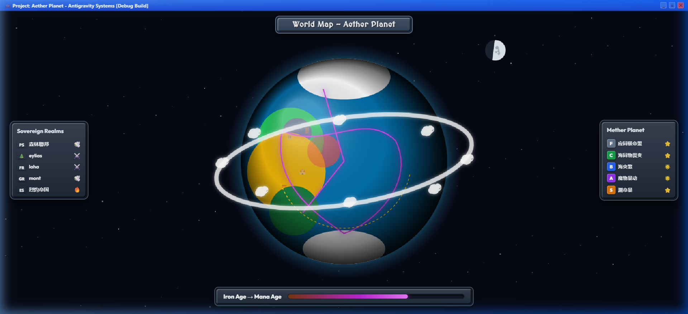
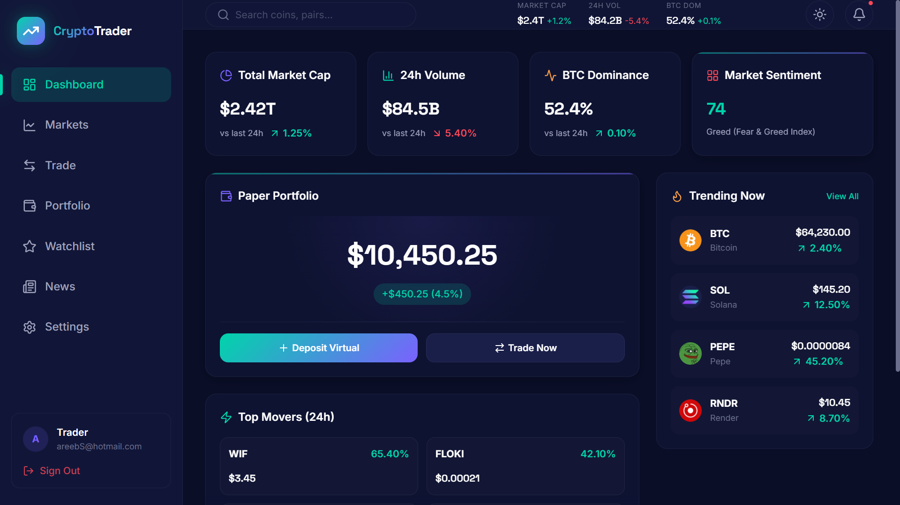
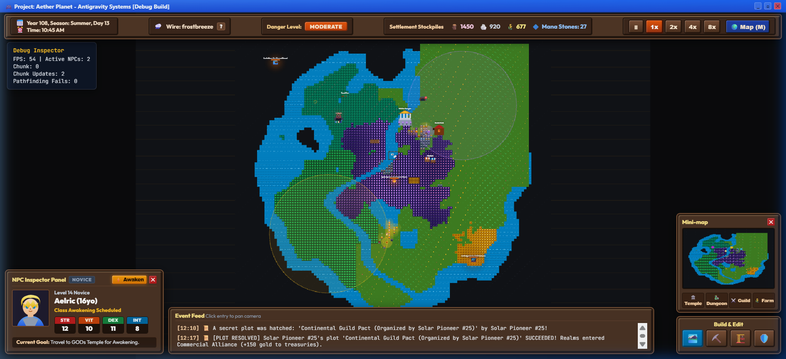
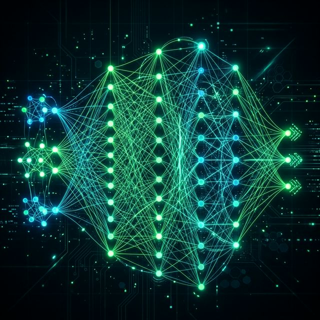
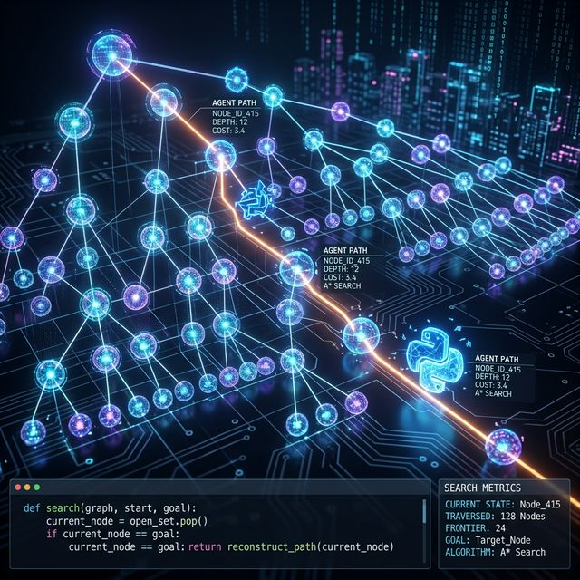

# 🏛️ Areeb Azhar — Architectural Portfolio (Beyond What You See)

[](https://areeb-azhar.github.io/portfolio-web/)
[](https://vite.dev/)
[](https://greensock.com/)
[](https://github.com/darkroomengineering/lenis)
[](https://www.thisisgazzar.com/en)
[](./LICENSE)

> 🌐 **Live Website**: [https://areeb-azhar.github.io/portfolio-web/](https://areeb-azhar.github.io/portfolio-web/)

An **Awwwards-caliber, museum-grade editorial digital experience** redesigned to match the aesthetic, interaction flow, and structural craftsmanship of **[Mohamed Elgazzar's portfolio (thisisgazzar.com)](https://www.thisisgazzar.com/en)**. Featuring deep obsidian tones (`#050505`), warm ivory typography (`#e4e1d9`), high-precision monospace accents, a Web Audio API micro-sound synthesizer, an optical perspective study, and **7 dedicated, museum-grade case study briefing pages**.

---

## 📸 Visual Showcase

| Cogniverse Cosmic View | CryptoTrader Dashboard |
|:---:|:---:|
|  |  |

| Blockchain Attestation | Cogniverse Tactical View |
|:---:|:---:|
|  |  |

| Adaptive Puzzle AI | Adversarial Agent |
|:---:|:---:|
|  |  |

---

## 🌟 Key Features & Workflow Architecture

### 1. Preloader & Sound Gate
- **Dynamic 00% → 100% Counter**: Smooth tabular readout with scaled SVG brand mark.
- **Auditory Experience Choice**: Visitors can enter in **`QUIET`** mode or with **`SOUND`** enabled.
- **Accessibility**: Includes a dedicated **`Reduce motion`** toggle.

### 2. Identity Hero & Minimalist Masthead
- **Brand Monogram**: Geometric sliced-arc `AA` monogram that rotates smoothly on interaction.
- **Floating Header**: Features dynamic role pills (`AI SYSTEMS & DISTRIBUTED ARCHITECTURE`), sound state toggle, fullscreen `MENU` switch, and rolling kinetic `Let's talk ↗` trigger.
- **Interactive Visual Canvas**: Minimalist geometric orbital wireframe responding organically to cursor movement.
- **Infinite Philosophy Marquee**: Continuous typography ticker delivering core architectural statements.

### 3. Chapter 01: A Study in Perspective
- **4 Optical Beats**:
  - `01 / 04: Look a little deeper.` — Software as living logic beneath the surface.
  - `02 / 04: A small shift.` — Moving from static code to continuous adaptation.
  - `03 / 04: A whole new perspective.` — Where mathematical rigor merges with human intuition.
  - `04 / 04: The details change everything.` — Sub-16ms neural execution and zero-entropy topologies.
- **The Triad Pillars**: `PERSPECTIVE` · `CLARITY` · `DIRECTION`.
- **Core Thesis**: *"Built on logic. Made to feel simple."*

### 4. Chapter 02: Selected Work Showcase
- **Continuous SVG Connector**: A single unbroken path tracing through all projects as the user scrolls.
- **Curated 7-Project Engineering Roster**:
  1. **Genesis Cogniverse 2D & 2.5D** (`projects/cogniverse-rpg.html`) — Godot 4 & Rust Living RPG Simulation with Infinite Axis Utility AI.
  2. **CryptoTrader Terminal** (`projects/crypto-dashboard.html`) — Production React 19 & TradingView paper trading simulator.
  3. **Adaptive Difficulty Engine** (`projects/adaptive-difficulty.html`) — Unity & C# real-time player telemetry and neural recalibration.
  4. **On-Chain Credential Attestation** (`projects/blockchain-attestation.html`) — Hyperledger Fabric & Zero-Knowledge Privacy Sandbox.
  5. **RustBot Autonomous Engine** (`projects/rustbot-engine.html`) — Pure Rust, Tokio, Axum, and local fuzzy vector memory store.
  6. **Alpha-Beta Search Agent** (`projects/alpha-beta-agent.html`) — Adversarial AI decision engine with Minimax heuristic pruning.
  7. **Amazing Giant Flowers** (`projects/giant-flowers.html`) — Custom Shopify Liquid luxury storefront & tailored digital commerce.

### 5. Dedicated Project Case Study Pages (`projects/*.html`)
Each project opens into its own dedicated briefing page adopting Gazzar’s 4-act structure:
- **Context Matrix**: Client/Domain, Timeline, Role, Tech Stack, and Live Demo/Repo links.
- **Act 01 (Starting Point)**: The fundamental problem and why standard solutions fail.
- **Act 02 (Architecture in Practice)**: Interactive 3-step sequence + technical SVG data-flow diagrams.
- **Act 03 (Engineering Deep Dive)**: Formulas, code logic, real screenshots, and benchmarks.
- **Act 04 (Through Line & Impact)**: Quantified production metrics.
- **Next Project Transition**: Seamless footer link continuing into the next system.

### 6. Fullscreen Architectural Navigation Overlay
- Fullscreen sliding curtain with high-contrast typography links (`01 HOME` to `05 CONTACT`).
- Live Pakistan Standard Time (PKT, UTC+5) clock ticking every second.
- Status indicator: `● AVAILABLE FOR SELECT ROLES`.

---

## 🛠️ Technology Stack

| Category | Technology | Purpose |
|---|---|---|
| **Build & Bundler** | [Vite 8](https://vite.dev/) | Multi-Page Application (MPA) bundling with zero-jank HMR |
| **Animation Engine** | [GSAP 3.14](https://greensock.com/) + ScrollTrigger | Timeline choreography, masked line reveals, and scrubbed SVG strokes |
| **Smooth Scrolling** | [Lenis 1.3](https://github.com/darkroomengineering/lenis) | Momentum-based, hardware-accelerated smooth inertia scrolling |
| **Audio Synthesis** | [Web Audio API](https://developer.mozilla.org/en-US/docs/Web/API/Web_Audio_API) | Programmatic tactile hover clicks (1400Hz) and resonant chimes (520Hz) |
| **Typography** | Questrial, Syne, JetBrains Mono | Editorial modernist sans paired with precision monospace accents |
| **Graphics** | Native HTML5 2D Canvas & Vector SVG | Zero-cost orbital wireframe and continuous vector connections |

---

## 📂 Project Architecture & File Structure

```
portfolio/
├── .gitignore                      # Git ignore rules for node_modules & dist
├── index.html                      # Homepage: Preloader, Hero, Perspective, Work, Systems, Footer
├── main.js                         # Main coordinator: Lenis, preloader, menu, clock, canvas, scroll triggers
├── package.json                    # Scripts and dependencies (vite, gsap, lenis, three)
├── style.css                       # Gazzar Obsidian design system & responsive layout
├── vite.config.js                  # Rollup multi-page build configuration for all 8 HTML entry points
├── js/
│   ├── case-study.js               # Reusable script for project briefing pages (Lenis, aside spy, audio)
│   ├── cursor.js                   # Precision magnetic cursor with lerp tracking
│   └── sound.js                    # Web Audio API synthesizer for tactile clicks and chimes
├── images/                         # Production project screenshots and media assets
│   ├── blockchain_admin.png        # Hyperledger registrar admin console
│   ├── blockchain_verify.png       # On-chain credential hash scanner
│   ├── cogniverse_cosmic.png       # FastNoiseLite 128x128 cosmic world view
│   ├── cogniverse_tactical.png     # Tactical village view with TileMapLayer
│   ├── crypto_dashboard.png        # TradingView interactive candlestick terminal
│   ├── crypto_login.png            # Session authentication modal
│   ├── proj_alphabeta.png          # Alpha-Beta pruning decision tree
│   ├── proj_puzzle_ai.png          # Unity real-time neural gameplay
│   ├── proj_shopify.png            # Mobile product catalog
│   └── shopify_landing_pdf.jpg     # Luxury storefront hero
└── projects/                       # Dedicated Case Study Briefing Pages
    ├── adaptive-difficulty.html    # Unity & C# Neural Game Telemetry Engine
    ├── alpha-beta-agent.html       # Python Minimax Adversarial Heuristic Agent
    ├── blockchain-attestation.html # Hyperledger Fabric On-Chain Attestation & ZK Sandbox
    ├── cogniverse-rpg.html         # Godot 4 & Rust Living Sovereign RPG Engine
    ├── crypto-dashboard.html       # React 19 & TradingView CryptoTrader Terminal
    ├── giant-flowers.html          # Custom Shopify Liquid Luxury E-Commerce
    └── rustbot-engine.html         # Pure Rust Tokio High-Concurrency Chat Engine
```

---

## 🚀 Foolproof Local Setup & Running Guide

### Prerequisites
- **Node.js**: Version 18.0.0 or higher ([Download Node.js](https://nodejs.org/))
- **npm**: Version 9.0.0 or higher (bundled with Node.js)

### Installation Steps

1. **Clone the repository**:
   ```bash
   git clone <repository-url>
   cd portfolio
   ```

2. **Install dependencies**:
   ```bash
   npm install
   ```

3. **Run the local development server**:
   ```bash
   npm run dev
   ```
   Open your browser and navigate to `http://localhost:3000/`.

4. **Build for production**:
   ```bash
   npm run build
   ```
   Vite will compile and optimize all 8 HTML pages, bundling assets into the `dist/` directory.

5. **Preview the production build**:
   ```bash
   npm run preview
   ```
   Serves the production bundle locally at `http://localhost:4173/`.

---

## 📐 Verification & Quality Assurance

- **Multi-Page Compilation**: Validated with `npm run build` — compiles `index.html` and all 7 case studies with zero errors in &lt; 300ms.
- **Cross-Route Navigation**: Tested with browser subagent — verified seamless transitions from homepage cards to `/projects/*.html` and reciprocal `← BACK TO PROJECTS` links.
- **Web Audio Integration**: Validated on both `QUIET` and `SOUND` states with non-blocking audio context resumption.
- **Responsive Layout**: Fluid down to 320px mobile screens with collapsible navigation drawers and touch-optimized tap targets.

---

## 👤 Author

**Areeb Azhar**
- **GitHub**: [@AREEB-AZHAR](https://github.com/AREEB-AZHAR)
- **Email**: [areebazhar3@gmail.com](mailto:areebazhar3@gmail.com)
- **Portfolio**: [Live Showcase](https://areeb-azhar.github.io/portfolio/)
