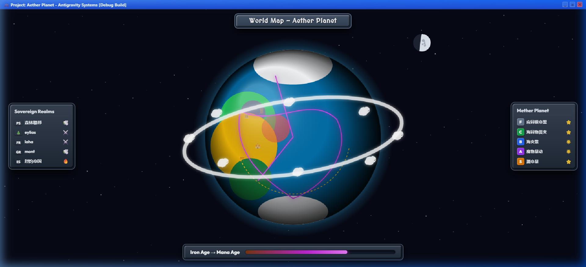
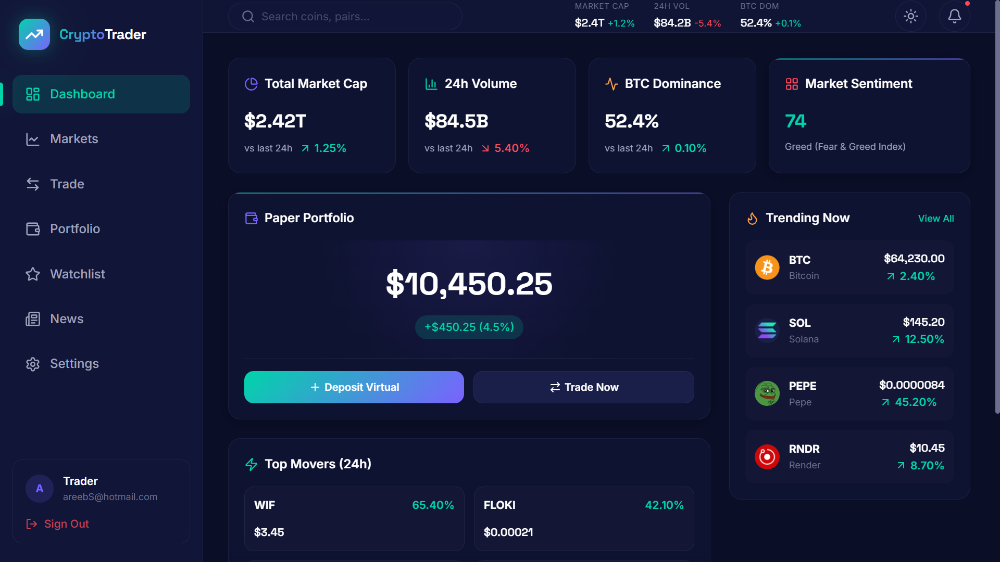
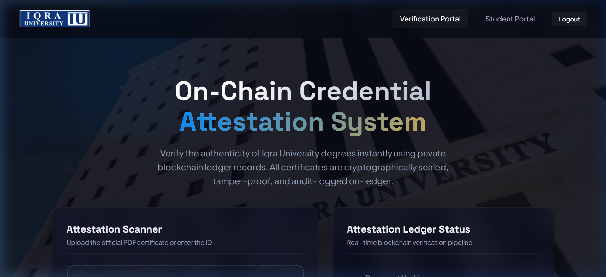
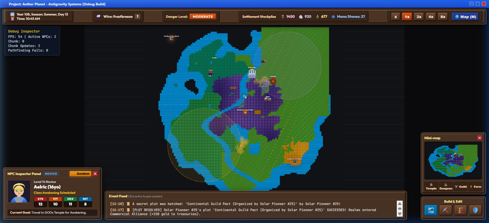
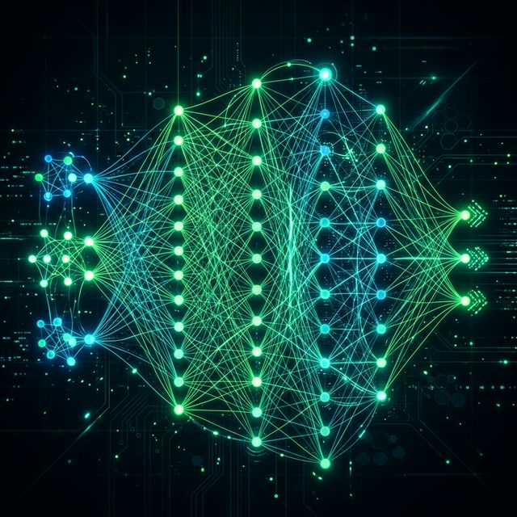
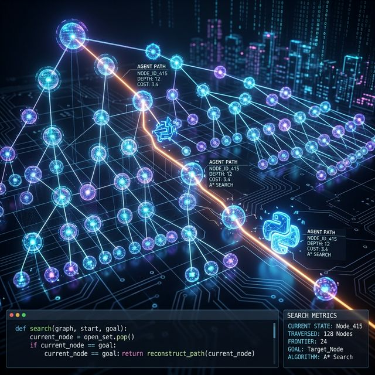

# 🏛️ Areeb Azhar — 3D Portfolio Archive Gallery & Editorial Showcase

[](https://areeb-azhar.github.io/portfolio-web/)
[](https://threejs.org/)
[](https://vite.dev/)
[](https://greensock.com/)
[](https://github.com/darkroomengineering/lenis)
[](./LICENSE)

> 🌐 **Live Website (3D Gallery Landing)**: [https://areeb-azhar.github.io/portfolio-web/](https://areeb-azhar.github.io/portfolio-web/)  
> 📖 **2D Editorial Archive**: [https://areeb-azhar.github.io/portfolio-web/editorial.html](https://areeb-azhar.github.io/portfolio-web/editorial.html)

An **interactive 3D Portfolio Archive Gallery** built with Three.js & WebGL, seamlessly connected to a preserved **Gazzar-inspired 2D Obsidian Editorial Portfolio** (`editorial.html`) and **7 dedicated technical case-study briefing pages** (`projects/*.html`).

---

## ✨ Recent Updates

- **3D Portfolio Archive Gallery Landing Page (`index.html`)**: Replaced the root landing page with a walkable cinematic WebGL architectural hall showcasing 6 portfolio eras (2021–2026) with procedural canvas textures, floating pedestal sculptures, volumetric light shafts, floorplan radar minimap, cinema letterbox bars, Web Audio ambient pad, and an interactive Portfolio Inspector Modal.
- **Preserved 2D Gazzar Editorial Portfolio (`editorial.html`)**: Preserved the full obsidian editorial experience as an accessible 2D archive linked from the 3D Gallery's Top HUD (`Editorial`), Splash Screen, Edition 05 (*Noir Cinema*), and WebGL fallback.
- **Interactive Project Deep-Links (Desktop & Mobile)**: Featured project cards inside the 3D Inspector Modal link directly into the 7 full project case-study briefings with touch-friendly tap targets, `touch-action: none` 3D drag look, and responsive mobile HUD/D-Pad ergonomics.
- **Three.js Performance & Memory Governance**: Reuses a single `CanvasTexture` for the monument wall, disposes previous GPU textures on live exhibit customization, hoists per-frame `THREE.Vector3` scratch objects outside `animate()` for zero GC stutter, and pauses rendering when the browser tab is hidden via `visibilitychange`.

---

## 📸 Visual Showcase

### Project Screenshots
| Cogniverse Cosmic View | CryptoTrader Dashboard |
|:---:|:---:|
|  |  |

| Blockchain Attestation | Cogniverse Tactical View |
|:---:|:---:|
|  |  |

| Adaptive Puzzle AI | Adversarial Agent |
|:---:|:---:|
|  |  |

> 📷 **3D Gallery Screenshots**: Capture screenshots of the new 3D landing page (1. **Title Splash over the 3D Hall**, 2. **First-Person Walkthrough with Minimap & Monoliths**, and 3. **Interactive Portfolio Inspector Modal**) into `images/` to showcase the WebGL hall right here!

---

## 🌟 Experience Architecture & Features

### 1. Interactive 3D Archive Gallery (`index.html`)
- **Cinematic Title Splash**: Sweeping crane shot over the live 3D hall with **Enter Gallery**, **Cinematic Auto-Tour**, and a direct **2D Editorial Portfolio** switch.
- **First-Person Exploration & Mobile Support**:
  - **Desktop**: `WASD` / Arrow keys to walk, Click & Drag to look, Click monolith or press `E` to inspect, Keys `1`–`6` to jump between eras, `Esc` to close.
  - **Mobile / Touch**: On-screen touch D-Pad, touch-drag camera look (`touch-action: none` preventing accidental pull-to-refresh), horizontal scrollable edition dock, and generous tap targets.
- **Six Curated Portfolio Monoliths (2021–2026)**:
  1. `ED. 01 (2021)` **Mono Terminal** — Command-Line Developer Archive
  2. `ED. 02 (2022)` **Swiss Editorial** — International Typographic Grid
  3. `ED. 03 (2023)` **Neo-Brutalist Lab** — Raw Borders & Kinetic Color
  4. `ED. 04 (2024)` **Aurora Glass** — Luminous Bento & Frosted Depth (`bunetto.vercel.app`)
  5. `ED. 05 (2025)` **Noir Cinema** — Monochrome Editorial Monograph (launches `./editorial.html`)
  6. `ED. 06 (2026)` **Spatial Atelier** — Full-Stack Systems & 3D Flagship (`RustBot` & `IqraDegreeChain`)
- **Live Exhibit Customizer**: Edit any exhibit's title, year, accent hex color, URL/path, or curatorial note inside the modal and watch the 3D monolith and wall plaque regenerate live (persisted in `localStorage` with proper GPU texture disposal).
- **Web Audio Ambient Cinema Pad**: Toggleable warm multi-oscillator museum drone and chime feedback via Web Audio API.
- **Graceful WebGL Fallback**: If WebGL is unavailable on a device, visitors are offered a direct one-click button to `./editorial.html`.

### 2. 2D Editorial Portfolio (`editorial.html`)
- **Preloader & Sound Gate**: `00% → 100%` counter with geometric `AA` monogram, `ENTER QUIETLY` / `ENTER WITH SOUND`, and `Reduce motion`.
- **Optical Perspective & Triad Narrative**: 4 scroll-triggered optical beats leading into `PERSPECTIVE`, `CLARITY`, and `DIRECTION`.
- **Fullscreen Architectural Menu**: Complete multi-layer visibility containment (`visibility: hidden`, `opacity: 0`, `overflow-y: auto`), Lenis scroll lock, live PKT clock, and direct link back to the `3D Archive Gallery`.

### 3. Seven Dedicated Project Case-Study Briefings (`projects/*.html`)
Every project opens into a 4-act editorial briefing with context matrices, architecture SVG diagrams, benchmarks, and `← BACK TO PROJECTS` (`../editorial.html#work`) + logo (`../index.html`) navigation:
1. **Genesis Cogniverse 2D & 2.5D** (`projects/cogniverse-rpg.html`) — Godot 4 & Rust Living RPG Simulation with Infinite Axis Utility AI.
2. **CryptoTrader Terminal** (`projects/crypto-dashboard.html`) — React 19 & TradingView paper trading simulator.
3. **Adaptive Difficulty Engine** (`projects/adaptive-difficulty.html`) — Unity & C# real-time player telemetry and neural recalibration.
4. **On-Chain Credential Attestation** (`projects/blockchain-attestation.html`) — Hyperledger Fabric & Zero-Knowledge Privacy Sandbox.
5. **RustBot Autonomous Engine** (`projects/rustbot-engine.html`) — Pure Rust, Tokio, Axum, SQLite, and local fuzzy vector memory store.
6. **Alpha-Beta Search Agent** (`projects/alpha-beta-agent.html`) — Adversarial AI Minimax engine with heuristic pruning.
7. **Amazing Giant Flowers** (`projects/giant-flowers.html`) — Custom Shopify Liquid luxury storefront & tailored digital commerce.

---

## 🛠️ Technology Stack

| Category | Technology | Purpose |
|---|---|---|
| **3D Graphics Engine** | [Three.js r128](https://threejs.org/) | Real-time WebGL architectural gallery, procedural canvas textures, collision detection |
| **Utility Styling (3D HUD)** | [Tailwind CSS 3.4](https://tailwindcss.com/) + [Lucide Icons](https://lucide.dev/) | Glassmorphic HUD overlays, responsive inspector modal, touch controls |
| **Build & Bundler** | [Vite 8](https://vite.dev/) | Multi-Page Application (MPA) bundling for all 9 HTML entry points |
| **Editorial Motion** | [GSAP 3.14](https://greensock.com/) + [Lenis 1.3](https://github.com/darkroomengineering/lenis) | Smooth momentum scrolling, masked reveals, and scrubbed SVG strokes on `editorial.html` & case studies |
| **Audio Synthesis** | [Web Audio API](https://developer.mozilla.org/en-US/docs/Web/API/Web_Audio_API) | Ambient museum drone pad (`index.html`) & tactile hover/click synthesis (`editorial.html`) |
| **Typography** | Cormorant Garamond, Inter, Questrial, Syne, JetBrains Mono | Editorial serif/grotesque display paired with technical monospace |

---

## 📂 Project Architecture & File Structure

```
portfolio/
├── .github/workflows/deploy.yml    # Automated GitHub Pages build & deployment on push to main
├── .gitignore                      # Git ignore rules for node_modules & dist
├── index.html                      # Primary Landing: Interactive 3D Portfolio Archive Gallery (Three.js)
├── editorial.html                  # Preserved 2D Gazzar Obsidian Editorial Portfolio
├── main.js                         # Editorial coordinator: Lenis, preloader, menu, clock, orbital canvas
├── style.css                       # Editorial & case-study Obsidian design system
├── vite.config.js                  # Rollup MPA build config (base: '/portfolio-web/', 9 HTML inputs)
├── package.json                    # Scripts and dependencies (vite, gsap, lenis, three, vanta)
├── js/
│   ├── case-study.js               # Reusable case-study script (Lenis, scroll-spy aside, audio)
│   ├── cursor.js                   # Precision magnetic cursor with lerp tracking
│   └── sound.js                    # Web Audio API micro-sound synthesizer
├── images/                         # Production project screenshots and media assets
│   ├── blockchain_admin.png
│   ├── blockchain_verify.png
│   ├── cogniverse_cosmic.png
│   ├── cogniverse_tactical.png
│   ├── crypto_dashboard.png
│   ├── crypto_login.png
│   ├── proj_alphabeta.png
│   ├── proj_puzzle_ai.png
│   ├── proj_shopify.png
│   └── shopify_landing_pdf.jpg
└── projects/                       # 7 Dedicated Case-Study Briefing Pages
    ├── adaptive-difficulty.html
    ├── alpha-beta-agent.html
    ├── blockchain-attestation.html
    ├── cogniverse-rpg.html
    ├── crypto-dashboard.html
    ├── giant-flowers.html
    └── rustbot-engine.html
```

---

## 🚀 Foolproof Local Setup & Running Guide

### Prerequisites & Environment Setup
- **Node.js**: Version `18.0.0` or higher (CI uses Node `20`) — [Download Node.js](https://nodejs.org/)
- **npm**: Version `9.0.0` or higher (bundled with Node.js)
- **Browser**: Any modern desktop or mobile browser with WebGL enabled (automatic fallback to `editorial.html` if WebGL is disabled). No environment variables or `.env` files are required.

### Installation & Local Execution

1. **Clone the repository**:
   ```bash
   git clone https://github.com/AREEB-AZHAR/portfolio-web.git
   cd portfolio-web
   ```

2. **Install dependencies**:
   ```bash
   npm install
   ```

3. **Run the local development server**:
   ```bash
   npm run dev
   ```
   Open `http://localhost:3000/portfolio-web/` (Vite automatically serves under the configured `base: '/portfolio-web/'` path).

4. **Build for production**:
   ```bash
   npm run build
   ```
   Vite bundles all 9 HTML entry points (`index.html`, `editorial.html`, and all 7 `projects/*.html`) into `dist/`.

5. **Preview the production build locally**:
   ```bash
   npm run preview
   ```
   Open `http://localhost:4173/portfolio-web/` to inspect the exact GitHub Pages production bundle.

---

## 📐 Verification & Quality Assurance

- **Multi-Page Build**: Validated via `npm run build` — all 9 HTML entry points and optimized assets build cleanly in ~400ms with 0 errors.
- **Automated Link & Syntax Audit**: Verified all 58 internal relative links across `dist/index.html`, `dist/editorial.html`, and `dist/projects/*.html`, plus full JS syntax validation of the 3D gallery script.
- **Three.js Resource Audit**: Verified single monument texture reuse, GPU texture `.dispose()` on live exhibit customization, hoisted `Vector3` scratch variables, and `visibilitychange` background pause.

---

## 👤 Author

**Areeb Azhar**
- **GitHub**: [@AREEB-AZHAR](https://github.com/AREEB-AZHAR)
- **Email**: [areebazhar3@gmail.com](mailto:areebazhar3@gmail.com)
- **Live Portfolio**: [https://areeb-azhar.github.io/portfolio-web/](https://areeb-azhar.github.io/portfolio-web/)
